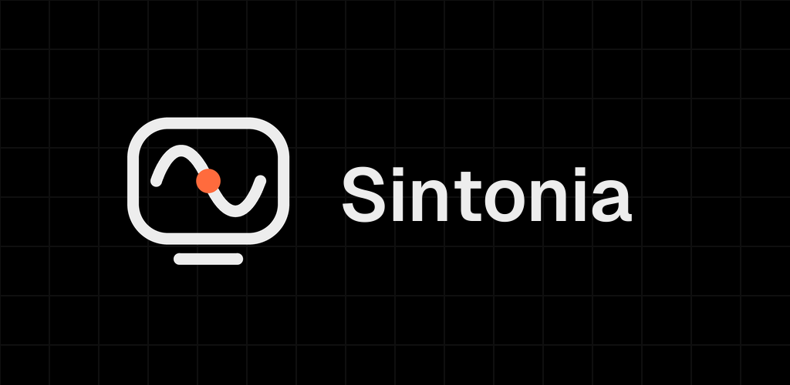

<div align="center">


# Sintonia

An IPTV player for Android phones and Android TV, written in Jetpack Compose.

[](https://github.com/danielcrvo/sintonia/actions/workflows/ci.yml)
[](https://github.com/danielcrvo/sintonia/releases/latest)
[](https://github.com/danielcrvo/sintonia/releases/tag/nightly)
[](LICENSE)

</div>

Sintonia only plays. It ships no channels, movies or series: you add the list from your own provider (Xtream Codes, M3U link or M3U file) and everything stays on your device. There is no account, backend, ads or tracking.



## Download

Get an APK from the [latest release](https://github.com/danielcrvo/sintonia/releases/latest). Files are named `Sintonia-<version>-<abi>.apk`:

| ABI | Use it on |
|---|---|
| `arm64-v8a` | recent phones and TVs |
| `armeabi-v7a` | older phones, TV boxes and set-top boxes |
| `x86_64` | emulators and some Chromebooks |
| `universal` | anything, at a larger size |

Daily test builds are in the [nightly pre-release](https://github.com/danielcrvo/sintonia/releases/tag/nightly). Sintonia needs Android 7.0 (API 24) or newer.

## Features

* Live TV with categories, favorites, a programme guide and channel zapping. On TV, the guide is a time grid.
* Movies and series with details, seasons, resume and next episode.
* Search across channels, movies and series.
* Rename and hide categories.
* Parental control with a PIN and blocked categories.
* Several lists, with one active at a time. Lists refresh in the background.
* Audio and subtitle language preferences.
* Light, dark or automatic theme. Portuguese (Brazil), English and Spanish, switched without a restart.
* One codebase for phone and Android TV, fully usable with a D-pad.

## Building

You need JDK 17 or newer and the Android SDK.

```bash
./gradlew assembleDebug                                              # APK in app/build/outputs/apk/debug
./gradlew ktlintCheck detekt lintDebug testDebugUnitTest assembleDebug   # the main checks CI runs
```

The `scripts` folder has a mock Xtream server (`mock-xtream-server.mjs`, username and password `demo`) and a sample playlist generator (`generate-sample-playlist.mjs`), so you can test without a provider.

## Contributing

Pull requests are welcome. Read the [contributing guide](CONTRIBUTING.md) and the [code of conduct](CODE_OF_CONDUCT.md) first, and open an issue before starting anything large. The app is small on purpose, so features that need a backend, accounts or analytics will not be accepted. See the [changelog](CHANGELOG.md) for what changed in each version.

## Privacy

Sintonia collects nothing and sends nothing to the developer. Read the full [privacy policy](PRIVACY.md).

## Credits

* [Geist and Geist Mono](https://github.com/vercel/geist-font) by Vercel, under the [SIL Open Font License 1.1](https://openfontlicense.org). The font files are in `app/src/main/res/font`.
* The libraries declared in [`gradle/libs.versions.toml`](gradle/libs.versions.toml), mostly under the Apache License 2.0: AndroidX (Compose, Navigation 3, Room, Paging, DataStore, Media3, WorkManager), Kotlin and kotlinx, Hilt, OkHttp and Coil.

## Disclaimer

The developer has no affiliation with any content provider. Sintonia does not host, distribute or recommend content. Use only lists and content you have the right to access.

## License

Sintonia is free software, released under the [GPL-3.0-or-later](LICENSE).
